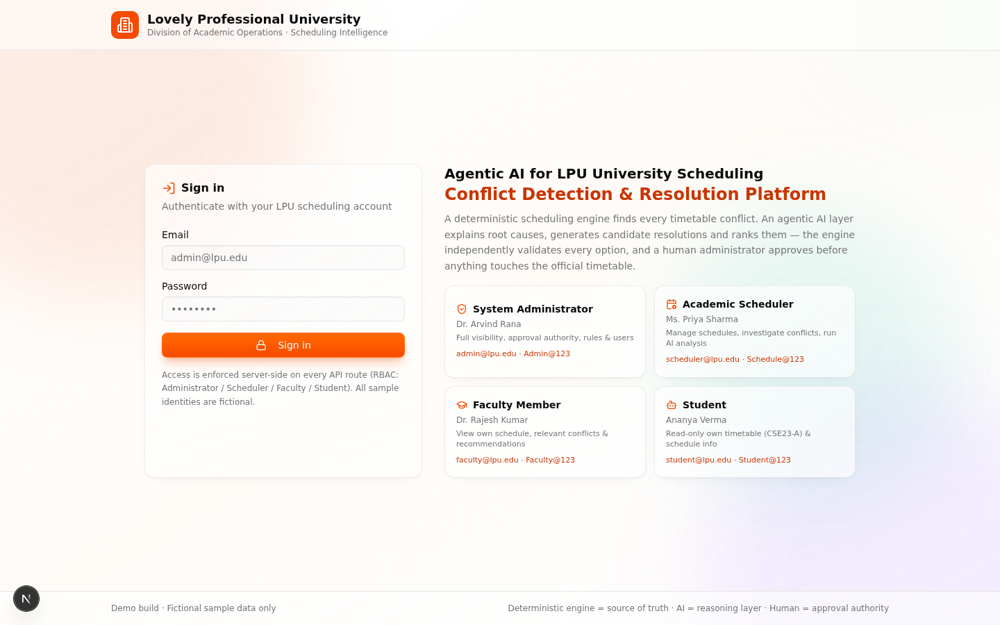
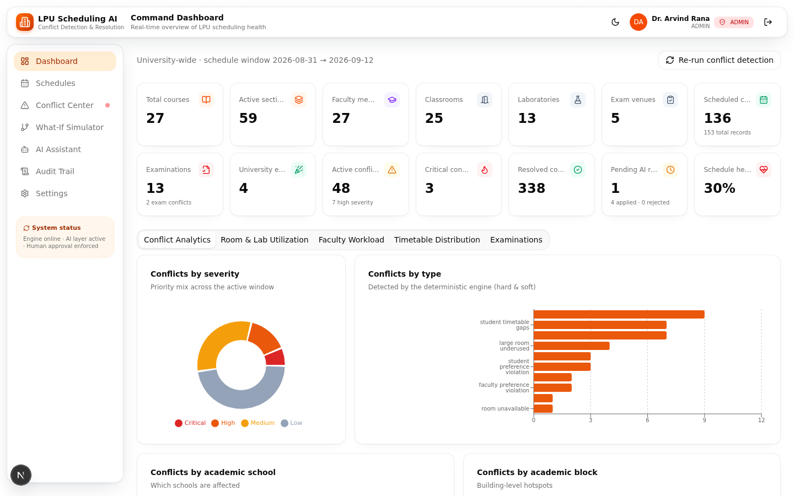
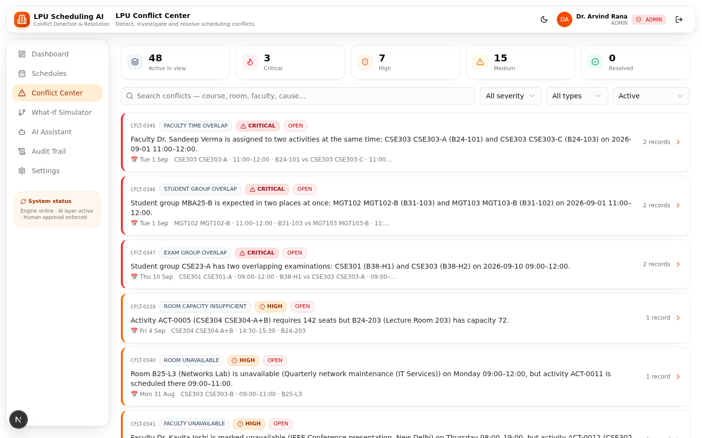
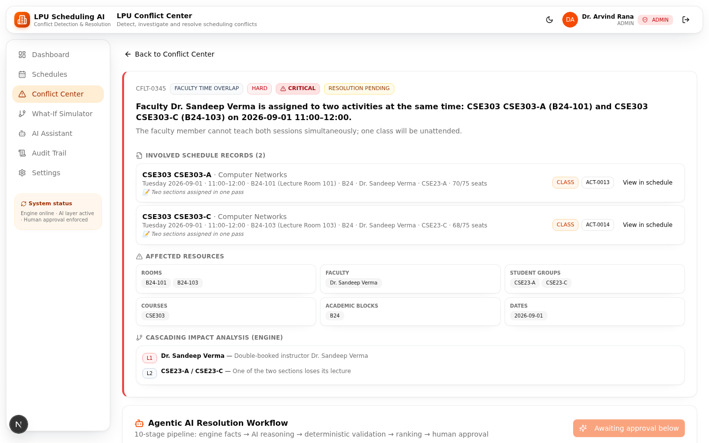
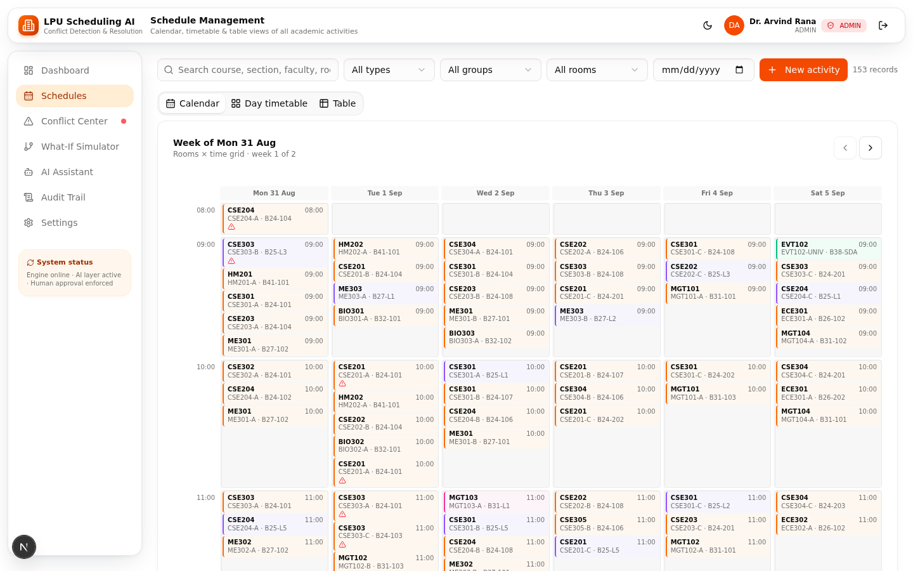
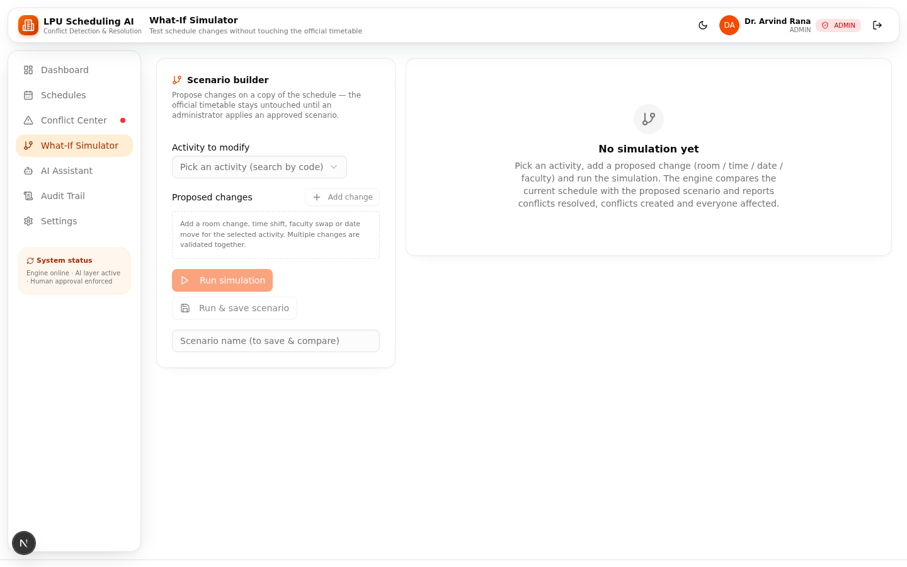
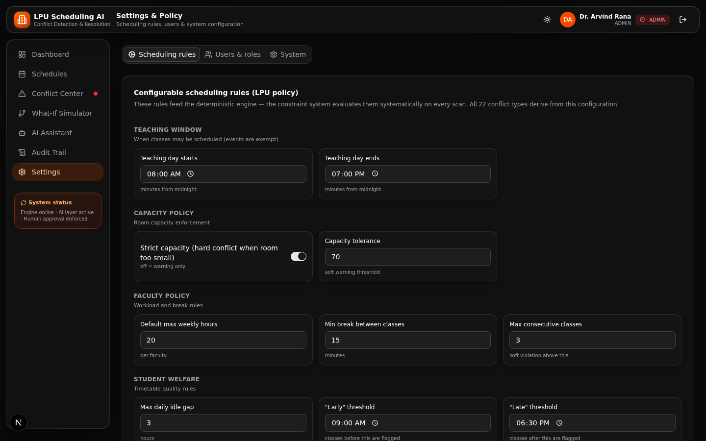
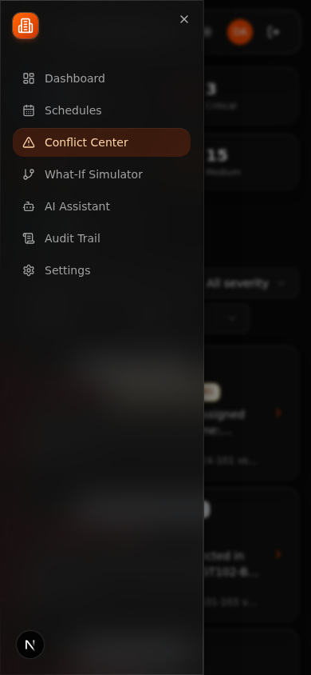

# Agentic AI for LPU University Scheduling Conflict Detection & Resolution

A production-quality platform for **Lovely Professional University (LPU)** that detects timetable conflicts deterministically, explains them with an agentic AI layer, generates and validates candidate resolutions, and applies changes only after **human approval**.

> **Authority model — the core design principle**
> - **Deterministic Scheduling Engine** = source of truth. It alone decides whether a conflict exists and whether a proposed change is valid.
> - **Agentic AI layer** = reasoning & explanation. It analyzes, narrates, plans and ranks — but can never declare a solution valid and can never touch the official timetable.
> - **Administrator** = approval authority. Every schedule change flows through the human-in-the-loop workflow.

## Screenshots

| Login | Command Dashboard |
|---|---|
|  |  |

| Conflict Center | 10-stage AI analysis |
|---|---|
|  |  |

| Schedule Management | What-If Simulator |
|---|---|
|  |  |

| Dark mode | Mobile (390×844) |
|---|---|
|  |  |

Full gallery (14 screenshots: all 7 views, AI pipeline, audit, settings, dark mode, mobile) in [`docs/screenshots/`](docs/screenshots/) · UI/UX design documentation in [`docs/UI_UX_DESIGN.md`](docs/UI_UX_DESIGN.md).

---

## 1. Quick start

```bash
bun install            # dependencies
bun run db:push        # create SQLite schema (db/custom.db)
bun run scripts/seed.ts  # load LPU sample data + first conflict scan
bun run dev            # http://localhost:3000
```

The app also **self-seeds on first load** (`POST /api/bootstrap` runs automatically when the database is empty).

### Demo credentials

| Role | Email | Password | What they can do |
|---|---|---|---|
| System Administrator | `admin@lpu.edu` | `Admin@123` | Everything: approve/reject AI recommendations, apply scenarios, rules, users, reset |
| Academic Scheduler | `scheduler@lpu.edu` | `Schedule@123` | Manage schedules, run AI analysis, simulate, reject — **cannot approve** |
| Faculty Member | `faculty@lpu.edu` | `Faculty@123` | View own schedule, own conflicts, permitted recommendations (read-only) |
| Student | `student@lpu.edu` | `Student@123` | Read-only own timetable (CSE23-A) & relevant schedule info |

All identities are **fictional sample records** — no real personal data.

### Automated tests

```bash
bun test tests/engine.test.ts    # 30 engine tests (all conflict types, validation, cascade, simulation)
bun run lint                     # ESLint
bun run scripts/smoke-test.ts    # full golden-path API workflow (login → resolve → approve → verify → audit)
bun run scripts/validate-engine.ts  # in-memory engine + generator validation
```

---

## 2. The end-to-end demonstration workflow

The system ships with a **golden-path demo scenario** built into the sample data:

1. **LPU schedule data** — two sections, `CSE301-A` (DBMS, Dr. Rajesh Kumar) and `CSE302-B` (Operating Systems, Dr. Kavita Joshi), are accidentally double-booked into **B24-105 (Gallery Hall)** on Monday **10:00–11:00** (copy-paste error from a spreadsheet import — visible in the record notes).
2. **Deterministic conflict detection** — the engine scans the complete schedule and registers a **CRITICAL ROOM_TIME_OVERLAP** (`CFLT-0007`).
3. **Conflict classification** — CRITICAL / HARD, with affected rooms, faculty, sections, student groups, blocks.
4. **Root-cause analysis** — engine facts + LLM narrative (why the double-booking happened, citing the record notes).
5. **Affected-resource identification** — rooms/faculty/groups/courses/blocks/dates panels in the Conflict Center.
6. **Cascading-impact analysis** — dependency chain: what happens downstream if either class is displaced.
7. **Agentic AI resolution planning** — the agent plans search strategies (relocate / shift / swap / reschedule).
8. **Multiple candidate solutions** — deterministic search generates ~28 candidates (alternative rooms, time slots, dates, faculty, swaps).
9. **Deterministic constraint validation** — every candidate is re-checked against the **complete current schedule** (28/28 pass, engine signature attached).
10. **Solution scoring & ranking** — 0–100 score (validity 40, resolution 20, soft-impact 15, disruption 15, efficiency 10).
11. **AI explanation** — LLM explains why the recommendation outranks alternatives, grounded only in validated facts.
12. **Administrator review** — the AI **cannot** apply anything; the request sits at `AWAITING_APPROVAL`.
13. **Approval** — admin approves → change applied to the official timetable (re-validated against the current state first).
14. **Complete conflict re-evaluation** — full engine re-scan runs automatically.
15. **Resolution confirmation** — “original conflict RESOLVED ✓ · 0 new conflict(s) · 48 total”.
16. **Audit-log entry** — SEED → AI_ANALYSIS_GENERATED → CHANGE_APPLIED → SOLUTION_APPROVED entries with before/after states and verification results.

### Deliberately seeded conflict landscape (11 hard conflict types, one of each)

| Type | Demo case |
|---|---|
| `ROOM_TIME_OVERLAP` | **Golden demo** — CSE301-A vs CSE302-B in B24-105 |
| `FACULTY_TIME_OVERLAP` | Dr. Sandeep Verma double-booked Tue 11:00 |
| `STUDENT_GROUP_OVERLAP` | MBA25-B in two rooms at once |
| `EXAM_GROUP_OVERLAP` | CSE23-A has two overlapping exams |
| `ROOM_CAPACITY_INSUFFICIENT` | 142-seat combined lecture in a 72-seat room |
| `ROOM_TYPE_MISMATCH` | Networks practical booked in a classroom |
| `EXAM_VENUE_INCOMPATIBLE` | MGT101 exam in a normal case room |
| `FACULTY_UNAVAILABLE` | class scheduled during faculty’s IEEE-conference leave |
| `ROOM_UNAVAILABLE` | lab booked during quarterly maintenance |
| `DUPLICATE_ACTIVITY` | CSE201-A entered twice |
| `INVALID_TIME` | BIO303 class at 19:30 (outside window) |

Plus soft conflicts: faculty overload, back-to-back chains, student gaps, uneven distribution, preference violations, idle rooms, large-room waste, block zig-zag.

---

## 3. Architecture

```
┌──────────────────────────────────────────────────────────────────────┐
│ FRONTEND (Next.js 16 App Router, single SPA route /)                 │
│  App Shell · Login · Dashboard · Schedule Mgmt · Conflict Center     │
│  What-If Simulator · AI Assistant · Audit Trail · Settings            │
│  Tailwind 4 + shadcn/ui + Recharts + TanStack Query + Zustand        │
└───────────────┬──────────────────────────────────────────────────────┘
                │  /api/* (fetch, session cookie)
┌───────────────▼──────────────────────────────────────────────────────┐
│ API LAYER (Next.js route handlers, NextAuth session)                 │
│  overview · activities CRUD · conflicts · detect · resolve ·          │
│  decision · simulate · assistant · audit · rules · users · reset      │
│  RBAC enforced server-side on every route (requireRole/requireAuth)  │
├───────────────┬───────────────────────────┬──────────────────────────┤
│ DETERMINISTIC │ AI ORCHESTRATION LAYER   │ DATA LAYER               │
│ SCHEDULING    │ (src/lib/ai)             │ (Prisma + SQLite)        │
│ ENGINE        │  agent.ts — 10-stage     │  loader.ts (DB→state)    │
│ (src/lib/     │    agentic pipeline      │  apply.ts (controlled    │
│  engine)      │  assistant.ts — grounded │    writes)               │
│  conflict-    │    NL assistant          │  seed.ts (sample data)   │
│  detector,    │  client.ts — z-ai SDK    │  16 models               │
│  constraint-  │    (LLM, backend only)   │                          │
│  validator,   │  LLM failures fall back │  AUDIT TRAIL             │
│  candidate-   │  to deterministic text   │  (AuditLog, append-only) │
│  generator,   │  — engine facts always   │                          │
│  scoring,     │  win over AI claims      │                          │
│  cascade,     │                           │                          │
│  simulator    │                           │                          │
└───────────────┴───────────────────────────┴──────────────────────────┘
```

**Clean separation guarantees:**

- `src/lib/engine/**` is **pure TypeScript** — zero imports from the database, AI, Next.js or React. It runs on plain `ScheduleState` objects and is fully unit-testable (`tests/engine.test.ts`).
- `src/lib/ai/**` may *read* engine results and call the LLM, but validity claims come exclusively from `constraint-validator.ts`.
- `src/lib/data/apply.ts` is the **only** module that writes validated changes to the official timetable — and only after re-validation.

---

## 3a. UI / UX — the Liquid Glass design system

The frontend uses a custom **"Liquid Glass"** design language (Apple iOS 26-inspired) implemented in `src/app/globals.css` on top of Tailwind 4 + shadcn/ui (49 primitives) + Radix UI, with Framer Motion 12 for view transitions.

- **Three-layer glass architecture** — a fixed ambient-light base (orange/teal/violet radial gradients from the LPU palette); `.glass-panel` content surfaces (translucent, *no* backdrop blur — performance); `.glass-float` chrome for the top bar, drawer, dialogs and popovers (`blur(20px) saturate(1.6)` + hairline reflection); plus `.glass-tint` / `.glass-ai` depth for colored panels.
- **One motion scale** — 150 ms micro-feedback, 200 ms dialogs/hover, 350 ms drawers/theme adaptation, all ease-out ("fast start, gentle settle").
- **Consistent signal colors** — severity (red/orange/amber/slate), status (red/amber/emerald/slate), activity type, and the ⚙ ENGINE / 🤖 AI AGENT / 👤 HUMAN actor badges that make the authority model *visible* in the UI.
- **Accessibility** — `prefers-reduced-transparency` (opaque surfaces + all blurs disabled), `@supports` fallback without `backdrop-filter`, `prefers-reduced-motion`, global `:focus-visible` outline, `scroll-padding-top` for the floating top bar, aria-labelled icon buttons.
- **Responsive** — role-filtered persistent navigation on desktop; Sheet drawer + stacked layout on mobile (verified at 390×844); full dark mode with re-tuned glass tokens.

Full design documentation — layer reference, tokens, motion table, component inventory, accessibility notes and a view-by-view UX walkthrough with all 14 screenshots — lives in **[`docs/UI_UX_DESIGN.md`](docs/UI_UX_DESIGN.md)**.

---

## 4. Database model (Prisma / SQLite)

| Model | Purpose |
|---|---|
| `User` | Accounts with role (`ADMIN / SCHEDULER / FACULTY / STUDENT`), scrypt-hashed passwords, optional links to faculty/student-group records |
| `AcademicBlock` | 8 blocks (B24, B25, B26, B27, B31, B32, B38, B41) |
| `School` | 6 schools (SCSE, SEEE, SME, SOM, SBAS, SOHM) |
| `Program` | 7 programs (BTech CSE/ECE/ME, MBA, BSc BIO/HM, GEN) |
| `Course` | 27 courses with type, lab requirement, exam duration, primary/backup faculty |
| `Faculty` | 27 members with weekly-hour caps, unavailable windows, preferences |
| `Room` | 45 rooms: classrooms, laboratories, exam venues, auditorium — capacity, features, unavailability |
| `StudentGroup` | 16 sections (CSE23-A…UNIV) with sizes |
| `Activity` | 153 schedule records: course/section/faculty/group/room/block/type/date/time/capacity/notes |
| `ConflictRecord` | Detected conflicts: type, category, severity, status, activity snapshot, affected resources, root cause, direct impact, cascade chain |
| `ResolutionRequest` | One AI analysis run: status, 10-stage log, LLM narrative, recommendation summary, decision fields |
| `CandidateSolution` | Per candidate: type, changes, `valid` flag, validation report, score, rank, reasoning, benefits, side effects |
| `SimulationScenario` | Saved What-If scenarios with results |
| `AuditLog` | Append-only trail: action, actor, conflict, before/after JSON, verification |
| `SchedulingRules` | Configurable rule set (JSON) driving the whole engine |

JSON payloads are stored as strings (SQLite has no JSON column type) and parsed in `loader.ts`.

---

## 5. The deterministic scheduling engine

**Hard conflicts (11 types):** room/lab time overlaps, faculty overlaps, student-group & exam-group overlaps (including exam spacing), capacity violations, room-type mismatches (lab sessions must be in labs; classes only in classrooms), exam-venue incompatibility, faculty/room unavailability, duplicate bookings (reported once — duplicate pairs are filtered from pair overlap checks), invalid time assignments, missing resources.

**Soft conflicts (10 types):** faculty overload (vs per-faculty cap), back-to-back chains (3+ without a break), student idle gaps, room underutilization, uneven weekly distribution, faculty/student preference violations, inconvenient early/late timings, large-room underuse, excessive block movement.

Every conflict carries: `conflictType, category, severity (CRITICAL/HIGH/MEDIUM/LOW), status, involved activities, affectedResources{rooms,faculty,studentGroups,courses,blocks,dates}, rootCause, directImpact, cascadingImpact[], signature` — the signature is a deterministic identity used for what-if diffing and cascade analysis.

**Rules are configurable** (`Settings → Scheduling rules`, persisted in `SchedulingRules`): teaching window, capacity strictness, workload caps, break/consecutive policies, gap thresholds, early/late bounds, utilization thresholds, large-room definitions, movement limits, exam venue strictness and spacing.

## 6. Constraint validation (sole validity authority)

`validateChanges(state, rules, changes, targetConflict)`:
1. Applies the changes to an in-memory **copy** of the complete schedule.
2. Re-runs full conflict detection on the mutated state.
3. Diffs before/after: confirms the target conflict is gone; rejects the change if **any new hard conflict** appears; reports new soft conflicts.
4. Runs structural checks: capacity, room type, exam venue, time window, faculty existence.

Reports include `engineVerified: true` and the check list — the UI displays them per candidate. The AI **never** sets these fields; the generator hands every candidate to the validator.

## 7. Candidate-resolution process

`generateCandidates` searches the real schedule state:
- alternative rooms / labs / exam venues (same slot, correct type, sufficient capacity, free, available)
- alternative standard time slots (room + faculty + group all free)
- alternative dates (working days, same time)
- room swaps between same-time activities (fits both ways)
- faculty reassignment (same school, free & available) for faculty conflicts
- combined room+time changes when nothing simpler works

`scoreAndRank` scores 0–100: validity 40, resolution 20, soft-impact 15 (new soft conflicts penalized), disruption 15 (students/faculty affected, swap multiplier, time-change multiplier), efficiency 10 (capacity fill, same-block bonus, time drift, complexity). Rank 1 = best; invalid candidates sink with the failure reason attached.

## 8. Agentic AI workflow (10 stages)

| # | Stage | Actor |
|---|---|---|
| 1 | Schedule understanding & analysis | AGENT |
| 2 | Conflict identification | **ENGINE** |
| 3 | Root-cause analysis (LLM over engine facts) | AGENT |
| 4 | Impact & dependency analysis | **ENGINE** |
| 5 | Resolution planning | AGENT |
| 6 | Candidate solution generation | **ENGINE** |
| 7 | Constraint validation | **ENGINE** (sole authority) |
| 8 | Scoring & ranking | **ENGINE** |
| 9 | Recommendation explanation (LLM) | AGENT |
| 10 | Human approval | **HUMAN** |

The pipeline is persisted per run (`ResolutionRequest.stages`) and rendered stage-by-stage in the UI with AGENT / ENGINE / HUMAN badges. LLM prompts include only engine-verified facts and are instructed never to invent data; on LLM failure the platform degrades to deterministic narratives (source badge shows `fallback`).

## 9. Human approval workflow

1. AI analysis completes → request `AWAITING_APPROVAL` (stage 10).
2. Admin reviews candidates, validation reports, reasoning, side effects; may leave a decision note.
3. **Approve** → the decision route re-validates the candidate against the **current** schedule (protection against stale recommendations — a 409 is returned if the schedule changed), applies changes through `apply.ts`, re-runs full detection, updates conflict status, writes audit entries.
4. **Reject** → recorded with note; no timetable change.
5. Schedulers can run analysis and reject, but approval is admin-only (403 otherwise) — enforced server-side.

## 10. Cascading-conflict mechanism

`analyzeCascade(state, rules, changes)` mutates a copy, re-detects, and diffs. The UI shows a dependency chain: **L0 changed activity → L1 directly touched resources → L2+ secondary conflicts actually detected by the engine** (with severity). Example shown in the What-If view: moving a class into a busy room surfaces the new room overlap plus knock-on group/faculty conflicts.

## 11. What-If simulation

`runSimulation` compares current vs proposed without touching the official timetable: conflicts resolved/created, affected faculty/student groups/rooms, capacity (bookings per room) and workload deltas, timetable changes, an overall impact score (−100…+100) and verdict. Scenarios can be saved and compared; an admin can apply one — the engine re-validates against the current schedule first (409 if stale), then applies + re-detects + audits.

## 12. Audit system

Append-only `AuditLog` rows for: `SEED, SCHEDULE_CREATED/UPDATED/DELETED, CONFLICT_DETECTION_RERUN, AI_ANALYSIS_GENERATED, SOLUTION_APPROVED/REJECTED, CHANGE_APPLIED, SIMULATION_CREATED/APPLIED, RULES_UPDATED`. Entries include actor, role, conflict code, full before/after JSON (original schedule state, conflict, analysis, recommendations, decisions, applied changes, post-change detection results and final state). Resolved conflicts are **kept** as `RESOLVED` rows so the full history remains inspectable; the Audit Trail view shows every entry with expandable JSON details.

## 13. AI Scheduling Assistant

Natural-language Q&A over live data (“Find all room conflicts tomorrow”, “Why is CSE301 conflicting?”, “Which faculty members have excessive workload?”…):
1. A deterministic intent router + entity extraction (course codes, conflict codes, activity codes, room/block codes, dates, groups) builds a query.
2. Real records are retrieved from DB/engine.
3. The LLM composes the answer using **only** those facts; references (conflict/activity/room codes) and the fact list are attached to every reply. Fallback: deterministic formatted answer.
4. Faculty/student roles get scoped answers (server-side).

## 14. Role-based access control

Enforced in `src/lib/session.ts` guards on **every** API route:

| Capability | ADMIN | SCHEDULER | FACULTY | STUDENT |
|---|---|---|---|---|
| View dashboard/analytics | full | full | own teaching | own group |
| Schedule CRUD, run detection/AI, simulate | ✓ | ✓ | ✗ | ✗ |
| Approve schedule changes | **✓ only** | ✗ (403) | ✗ | ✗ |
| Reject recommendations | ✓ | ✓ | ✗ | ✗ |
| Rules / users / reset | ✓ | ✗ | ✗ | ✗ |
| Timetable view | all | all | own | own (read-only) |

## 15. Project layout

```
prisma/schema.prisma           # 16-model database schema
scripts/seed.ts                # CLI seeding
scripts/smoke-test.ts          # golden-path API test
scripts/validate-engine.ts     # engine + generator validation
tests/engine.test.ts           # 30 automated engine tests
src/lib/engine/                # DETERMINISTIC ENGINE (pure TS, no deps)
src/lib/ai/                    # agent pipeline + assistant + LLM client
src/lib/data/                  # loader, seed, controlled apply, reference data
src/lib/auth.ts, session.ts    # NextAuth + RBAC guards
src/app/api/                   # 18 route groups
src/components/                # app shell + 7 feature views
python-service/                # isolated FastAPI analysis sidecar (see §19)
```

## 16. Configuration

| Key | Default | Purpose |
|---|---|---|
| `DATABASE_URL` | `file:./db/custom.db` | SQLite location (path relative to the project root; see `.env.example`) |
| `NEXTAUTH_SECRET` | set in `.env` | JWT session signing (generate with `openssl rand -base64 32`) |
| `PYTHON_SERVICE_URL` | `http://127.0.0.1:8000` | Base URL of the Python analysis service (server-side only — never exposed to the browser) |
| `PYTHON_SERVICE_TIMEOUT_MS` | `2000` | Bridge fetch timeout for Python service calls |

AI (GLM via `z-ai-web-dev-sdk`) is pre-configured — no API key needed in this environment; the SDK is **server-side only**. If the LLM is unavailable, all AI features degrade to deterministic output.

## 17. Production build & troubleshooting

```bash
bun run build && bun run start   # standalone production build
```

- **Empty dashboard / no data** → click *Settings → Reset demo data* or run `bun run scripts/seed.ts`.
- **Login fails** → ensure `NEXTAUTH_SECRET` is set and the user exists (reseed recreates accounts).
- **Approval returns 409** → the schedule changed since the candidate was generated; re-run the AI analysis.
- **“readonly database” after manual file operations** → restart the dev server (stale file handle).
- **Slow AI analysis (5–15 s)** → two LLM calls run sequentially; the pipeline view shows live progress.

## 18. Manual demo script (5 minutes)

1. Sign in as **Administrator** (one-click card on the login page).
2. **Dashboard** — review the 14 KPIs and the analytics tabs.
3. **Conflict Center** → open `CFLT-0007` (CRITICAL room overlap, B24-105) → inspect involved records, affected resources, cascade chain.
4. Click **Run AI analysis** → watch the 10-stage pipeline; expand stages; review the LLM root-cause narrative, ranked candidates, validation reports and the recommended solution.
5. **Approve & apply** → observe the post-change verification (original conflict resolved, 0 new conflicts) and the resolution note.
6. **Audit Trail** → inspect `AI_ANALYSIS_GENERATED`, `CHANGE_APPLIED`, `SOLUTION_APPROVED` entries with full JSON details.
7. **What-If Simulator** → pick any activity, propose a move, run the simulation, review the delta and dependency chain.
8. **AI Assistant** → ask “Find all room conflicts tomorrow”, “Why is CSE303 conflicting?”, “Which faculty members have excessive workload?”.
9. Sign in as **Scheduler** to see the 403 on approval; as **Student** to see the scoped timetable.

---

## 19. Python analysis service (FastAPI sidecar)

An isolated, advisory Python microservice lives in `python-service/`. It has its own directory, dependency set (`requirements.txt`, pinned), process and port (`127.0.0.1:8000`, loopback only). The Next.js backend is its **sole client** — browsers can never reach it (the gateway exposes only port 3000, and the service URL lives in server-side env config only).

**The authority model is unchanged.** The TypeScript engine remains the sole authority for conflict detection and constraint validation; the administrator remains the sole approval authority. Python may analyze, explain and rank engine-verified records — it never validates schedules, never touches the database, never approves or applies anything. Every proposed change still flows through the existing validation + admin-approval workflow. Nothing in the existing app depends on the Python service: if it is stopped, all existing features keep working.

```bash
# setup (isolated venv)
cd python-service && python3 -m venv .venv && .venv/bin/pip install -r requirements-dev.txt

# run / stop (detached daemon; logs → python-service/logs/service.log)
python3 scripts/service.py start | stop | status | probe

# tests
.venv/bin/python -m pytest tests/test_health.py                          # hermetic unit tests
RUN_INTEGRATION=1 .venv/bin/python -m pytest tests/test_live_integration.py  # live bridge + RBAC
```

**Integration surface (stage 1):**

- `GET /api/python-service` (ADMIN-only) — reports Python service health inside a structured JSON payload (`reachable`, `status ∈ {healthy, unreachable, error, timeout}`, `service`, `version`, `latencyMs`, `detail`, `checkedAt`). Python unavailability is reported inside the body — never as an unhandled 5xx.
- Bridge implementation: `src/lib/python-service.ts` (server-side only; hard timeout via `AbortController`, deterministic fallback, never throws).
- RBAC on the route is enforced server-side exactly like the other settings-tier routes (anonymous → 401, scheduler → 403).

**Stage-1 tests (all verified passing):** 8 pytest unit tests, 4 pytest live-integration tests, 6 bun bridge-contract tests (`tests/python-bridge.test.ts`: healthy / HTTP-500 / non-JSON / degraded-payload / connection-refused / timeout), plus `scripts/verify-python-bridge.ts up|down` for end-to-end verification of both the reachable and fallback modes. The 30 engine tests are untouched.

---

## License

MIT — see [`LICENSE`](LICENSE). All data is fictional sample data for demonstration purposes.
