# UI / UX Design Documentation — Liquid Glass Design System

This document describes the user interface and user experience of the **LPU University Scheduling Conflict Detection & Resolution** platform: the design language, the component inventory, the motion system, responsive behavior, accessibility guarantees, and a view-by-view UX walkthrough with screenshots.

All screenshots in `docs/screenshots/` were captured from the running application (1440×900 desktop, 390×844 mobile).

---

## 1. Design philosophy

The interface is built on a **"Liquid Glass"** design language inspired by Apple's iOS 26 visual direction, adapted to a data-dense enterprise scheduling tool. The design pursues three goals:

1. **Calm authority.** Scheduling data is dense; the chrome around it must be quiet. Translucent, softly-lit surfaces keep the focus on KPIs, timetables and conflict records — never on the container.
2. **Honest hierarchy.** Every visual layer maps to a real interaction tier: floating navigation chrome sits *above* content, content cards sit *on* the page, wells and grids sit *below* ambient content. A user can always tell what is navigation, what is data, and what is detail.
3. **Performance as a design constraint.** Backdrop blur is applied **only** to floating chrome (a handful of elements). Content surfaces use translucency and shadows without blur, so long lists and large tables scroll at full frame rate. The glass look never costs interactivity.

The palette derives from LPU's brand family — **orange** (primary/AI accent), **slate** (structure), **emerald** (success/resolved), **red** (critical), **amber** (warning), **violet** (labs/AI depth) — tuned to reduced opacity for glass surfaces.

---

## 2. The three-layer glass architecture

Defined in `src/app/globals.css`, the system layers surfaces from the page up:

| Layer | Class | Where it is used | Blur | Notes |
|---|---|---|---|---|
| Base | `body::before` ambient light | Fixed, behind everything | — | Three radial gradients (orange, teal, violet) at very low opacity |
| Main | `.glass-panel` | Cards, KPI tiles, chart containers, tables | **No blur** (performance) | Translucent background + hairline inset shadow |
| Floating | `.glass-float` | Top bar, mobile drawer, dialogs, popovers, sheets | `blur(20px) saturate(1.6)` | Plus a 1px hairline reflection gradient on `::before` (mask-composite technique) |
| Tinted | `.glass-tint` / `.glass-ai` | Existing colored translucent panels (emerald/red/orange info panels, AI panels) | `blur(12px)` | Adds glass depth without changing the element's own color |

Supporting utilities:

- `.glass-hover` / `.glass-hover-soft` — gentle shadow lift on hover for interactive rows vs. information-only tiles (no affordance lies: plain info never pretends to be clickable).
- `.glass-chip` / `.glass-ai-chip` — small translucent filter/suggestion chips, deliberately **without** backdrop blur (dozens of stacked blurs cost real GPU time).
- `.glass-well` — sunken inner surfaces for grid cells, code blocks and stage details.

Every token adapts between light and dark mode (`oklch(1 0 0 / 0.62)` float background in light; `oklch(0.205 0 0 / 0.62)` in dark).

### Ambient lighting

The page background carries three fixed radial gradients drawn from the LPU palette:

```css
background:
  radial-gradient(44rem 30rem at 6% -6%,  rgb(234 88 12 / var(--ambient-1)), transparent 62%),  /* orange  */
  radial-gradient(38rem 26rem at 98% 4%,  rgb(20 184 166 / var(--ambient-2)), transparent 62%),  /* teal    */
  radial-gradient(46rem 34rem at 80% 110%, rgb(139 92 246 / var(--ambient-3)), transparent 62%); /* violet  */
```

---

## 3. Color system

Semantic colors are CSS custom properties in `oklch` space (defined in `globals.css`, wired into Tailwind 4 via `@theme inline`), with full light and dark variants: `background`, `foreground`, `card`, `popover`, `primary`, `secondary`, `muted`, `accent`, `destructive`, `border`, `input`, `ring`, `chart-1…5`, plus the complete `sidebar-*` family.

Domain color coding is consistent across every view (see `src/components/shared/ui-bits.tsx`):

| Signal | Color family | Examples |
|---|---|---|
| Severity | red → orange → amber → slate | `CRITICAL`, `HIGH`, `MEDIUM`, `LOW` badges |
| Status | red (OPEN/FAILED), amber (AWAITING_APPROVAL), emerald (RESOLVED/APPLIED), slate (REJECTED) | lifecycle badges |
| Activity type | orange (CLASS), teal (TUTORIAL), violet (LAB), cyan (WORKSHOP), pink (SEMINAR), red (EXAM) | type badges |
| Actor | slate (⚙ ENGINE), orange (🤖 AI AGENT), emerald (👤 HUMAN) | pipeline stage badges |
| Role | red (ADMIN), orange (SCHEDULER), emerald (FACULTY), slate (STUDENT) | avatar chips |

Dark mode is class-based (`next-themes`, `.dark`) with a 350 ms theme-transition duration on glass surfaces, so switching feels like the surfaces adapting rather than a hard flip.

---

## 4. Motion system

One motion scale, applied consistently (`globals.css`):

| Token | Value | Used for |
|---|---|---|
| `--dur-fast` | 150 ms | menus, toasts, chips, micro-feedback |
| `--dur-base` | 200 ms | dialogs, popovers, hover states |
| `--dur-drawer` | 350 ms in / 250 ms out | mobile drawer, sheets |
| `--dur-theme` | 350 ms | surface color/shadow adaptation (theme switch) |

Easing is the ease-out family — fast start, gentle settle (Apple-style):

- `--ease-glass: cubic-bezier(0.25, 0.1, 0.25, 1)`
- `--ease-out-soft: cubic-bezier(0.16, 1, 0.3, 1)`

Framer Motion 12 drives view transitions and staged reveals (pipeline stages expand in sequence); `tw-animate-css` + `tailwindcss-animate` cover component enter/exit animations.

---

## 5. Accessibility

Four explicit mechanisms ship in `globals.css`:

1. **Reduced transparency** — `@media (prefers-reduced-transparency: reduce)` swaps glass backgrounds for opaque surfaces and disables *every* backdrop blur (custom classes and Tailwind utilities) with one blanket rule; ambient gradients are hidden.
2. **No backdrop-filter support** — `@supports not (…)` falls back to opaque backgrounds, so legacy browsers get a solid, readable UI.
3. **Reduced motion** — `@media (prefers-reduced-motion: reduce)` collapses animations/transitions to 0.01 ms and disables hover transforms.
4. **Keyboard focus** — a global `:focus-visible` outline (`2px solid var(--ring)`, offset 2px) fills the gaps left by shadcn primitives; the login cards, nav buttons and expanders are all keyboard operable.

Additional details:

- `scroll-padding-top: 88px` accounts for the floating top bar when browsers target anchors.
- `-webkit-tap-highlight-color: transparent` removes the gray tap flash over glass surfaces on mobile.
- Programmatic view changes scroll to top **instantly** (not smoothly), per accessibility guidance for large jumps.
- Refined thin scrollbars styled for both light and dark, including Firefox (`scrollbar-width`/`scrollbar-color`).
- Interactive elements carry `aria-label`s (e.g. "Open navigation", "Toggle theme", "Notifications (F8)").

---

## 6. Component inventory

**49 shadcn/ui primitives** in `src/components/ui/` (accordion, alert-dialog, avatar, badge, button, calendar, card, chart, command, dialog, drawer, dropdown-menu, form, popover, progress, resizable, scroll-area, select, sheet, sidebar, skeleton, slider, sonner/toast, table, tabs, tooltip, …) on Radix UI, styled by the glass tokens.

**Custom domain components** (`src/components/shared/ui-bits.tsx`):

- `SeverityBadge`, `StatusBadge`, `TypeBadge`, `ActorBadge` — the color-coded signal system above, each with an icon and light/dark variants.
- `KpiCard` — label, value, icon, tone (orange/red/green/slate/amber/violet) and hint; the dashboard's 14 KPIs are built from it.
- `EmptyState` — icon, title, description, optional action; every list and table has one so no view ever shows a blank void.

**Feature views** (`src/components/`):

| Directory | View |
|---|---|
| `app/` | `app-shell.tsx` (top bar, navigation, theme toggle, session), `login-view.tsx`, `providers.tsx` |
| `dashboard/` | `dashboard-view.tsx` — 14 KPIs + 5 analytics tab groups |
| `schedule/` | `schedule-view.tsx` (week calendar / day timetable / table), `activity-form-dialog.tsx` |
| `conflicts/` | `conflict-center.tsx`, `conflict-detail.tsx` |
| `whatif/` | `whatif-view.tsx` |
| `assistant/` | `assistant-view.tsx` |
| `audit/` | `audit-view.tsx` |
| `settings/` | `settings-view.tsx` |

Charts are Recharts (10 chart groups across the analytics tabs); tables are TanStack Table; forms are react-hook-form + Zod; server state is TanStack Query; view state is a small Zustand store (`src/store/app-store.ts`).

---

## 7. View-by-view UX walkthrough

### 7.1 Login

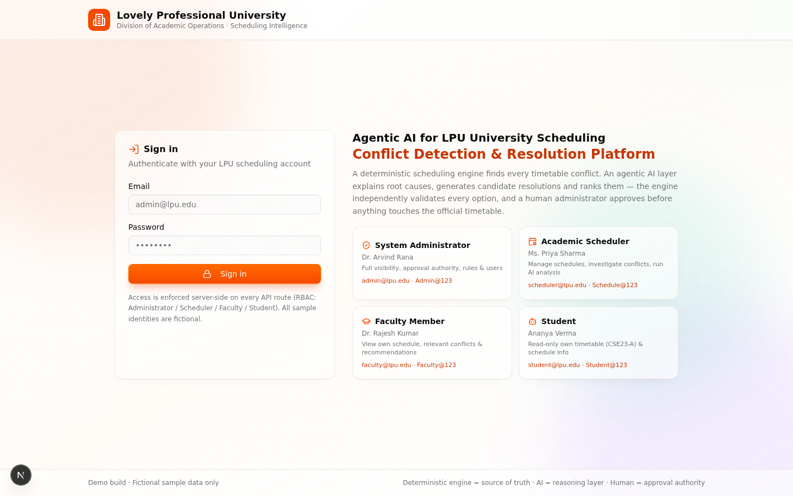

Split hero: the platform's purpose and authority model on one side, the sign-in form on the other. Four **one-click demo role cards** (Administrator, Scheduler, Faculty, Student) show each persona's name, capabilities and credentials — a new reviewer can be inside the app in one click and immediately understands what each role sees.

### 7.2 Command Dashboard

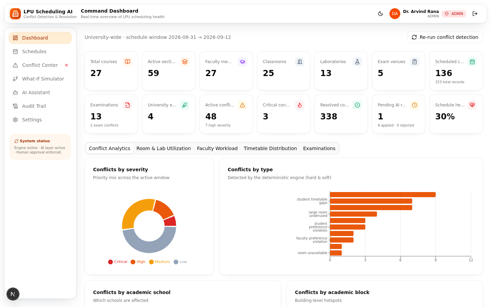

Real-time scheduling health: 14 KPI cards (open/critical conflicts, resolution rate, activities, utilization, workload peaks…), a **Re-run conflict detection** action, and five analytics tabs — Conflict Analytics, Room & Lab Utilization, Faculty Workload, Timetable Distribution, Examinations — each a chart group over live engine data.

### 7.3 Conflict Center

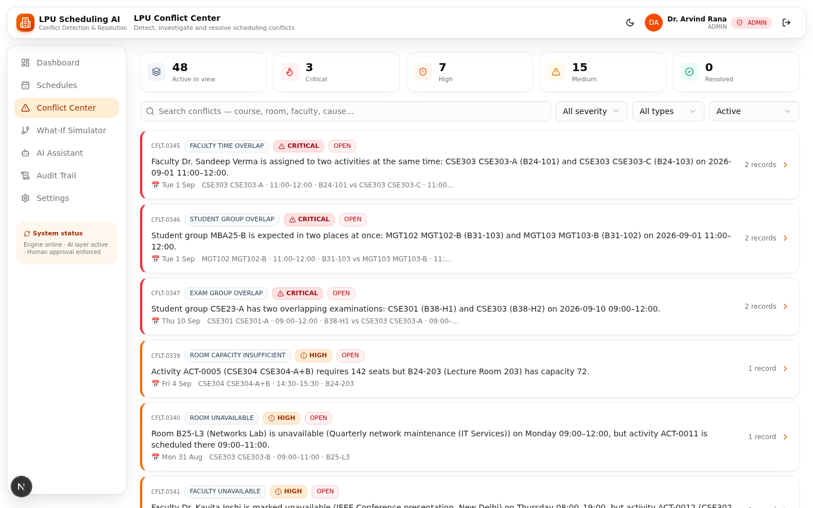

Filterable, searchable list of every detected conflict (severity, type, status filters). Rows carry severity/status/type badges and a plain-language summary. Each row opens the detail view.

### 7.4 Conflict detail

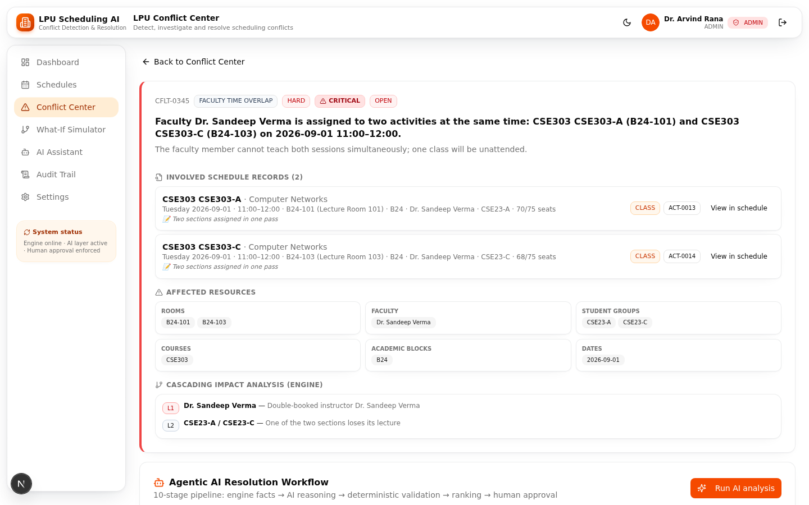

One conflict, fully explained: involved schedule records side-by-side (with "View in schedule" deep links), affected resources grouped by rooms / faculty / student groups / courses / blocks / dates, the engine's root cause and direct impact, and the cascade chain.

### 7.5 AI analysis (the 10-stage pipeline)

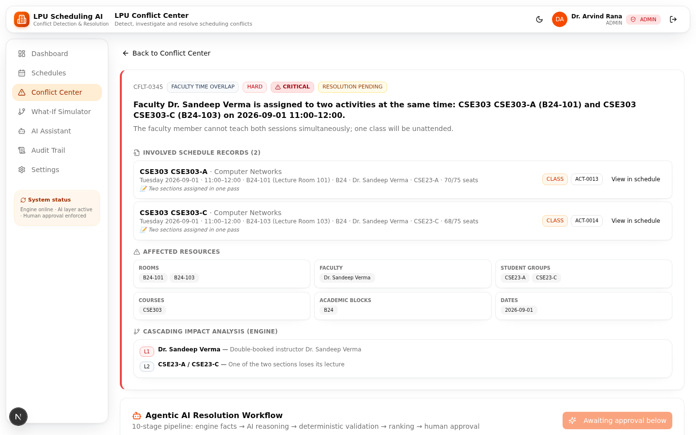

Pressing **Run AI analysis** executes the agentic pipeline and renders it stage-by-stage — each stage expandable, stamped with its actor badge (⚙ ENGINE / 🤖 AI AGENT / 👤 HUMAN) and completion time. The LLM root-cause narrative and recommendation explanation are grounded in engine-verified facts; ranked candidates show their validation report and 0–100 score. The approval footer states plainly that the AI cannot modify the timetable — only the administrator can decide.

### 7.6 Schedule Management

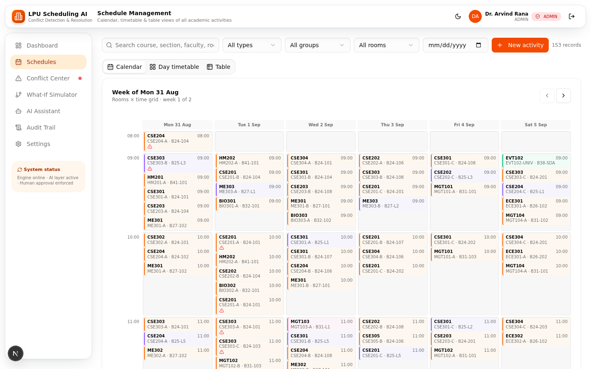

The whole timetable in three switchable modes — **week calendar**, **day timetable**, and **table** — with create/edit/duplicate/delete on activities. Week and day views color-code activity types; the table view is the dense, scannable fallback.

### 7.7 What-If Simulator

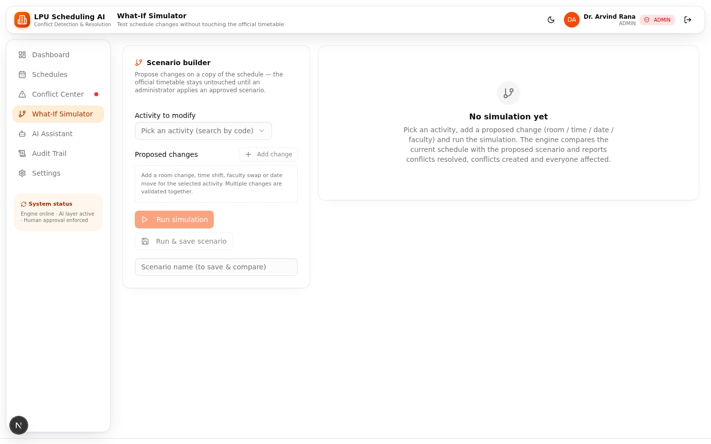

Pick any activity, propose a move (room, time, date), and simulate: conflicts resolved/created, affected resources, capacity and workload deltas, an impact score (−100…+100) and verdict, plus the L0→L1→L2+ dependency chain. Scenarios are saved and comparable; an admin can apply one (re-validated first).

### 7.8 AI Scheduling Assistant

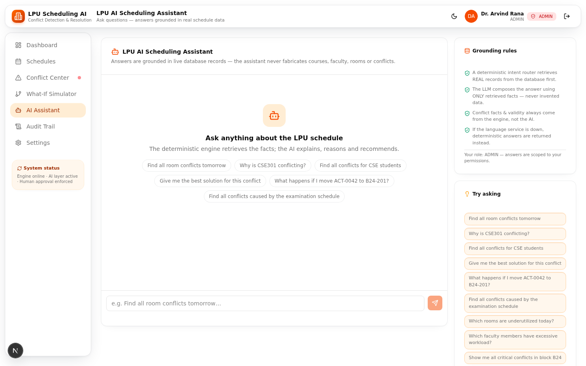

Natural-language Q&A over live data, with suggestion chips to start. Every answer attaches its references (conflict/activity/room codes) and the fact list it was grounded on — the anti-hallucination contract made visible. Faculty/student roles get scoped answers.

### 7.9 Audit Trail

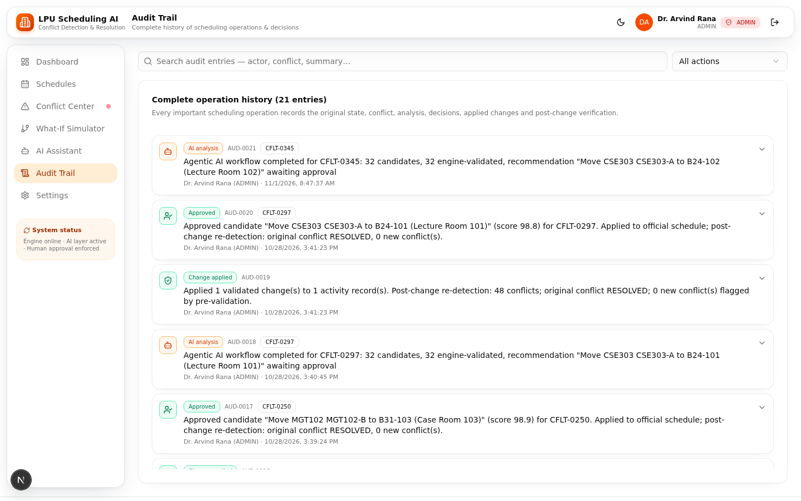

Append-only history of every operation — seeding, detection runs, AI analyses, decisions, applied changes — each entry expandable to the full before/after JSON. Resolved conflicts are kept, so the platform's story is never lost.

### 7.10 Settings & Policy

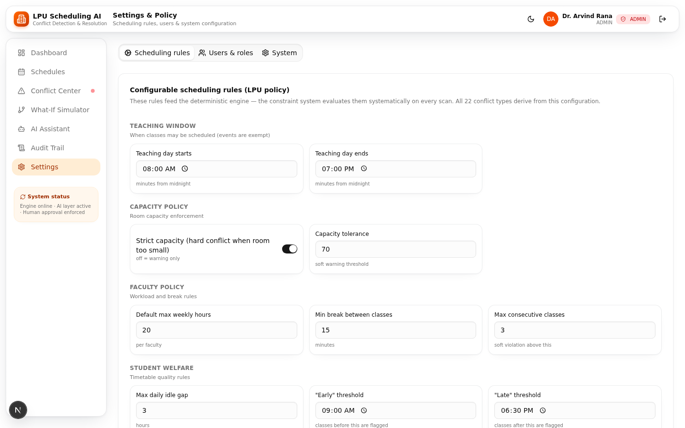

Admin-only: the configurable scheduling rules that drive the engine (teaching window, workload caps, break policies…), user management, and system actions.

### 7.11 Dark mode

| Dashboard (dark) | Conflict Center (dark) |
|---|---|
| 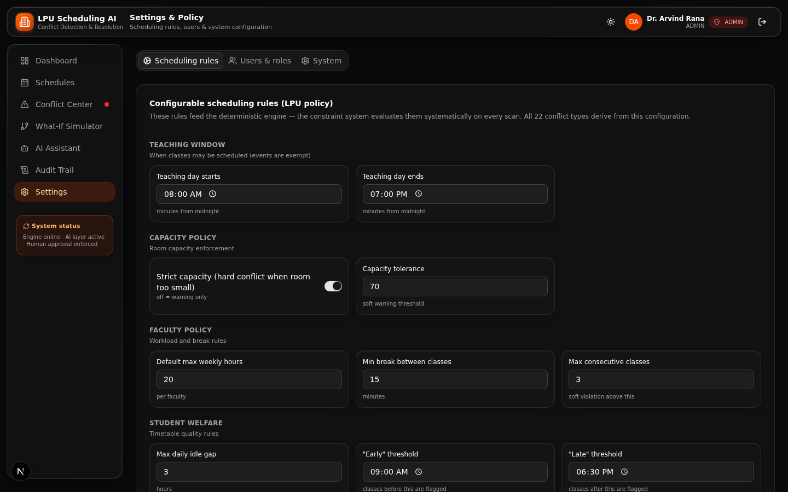 | 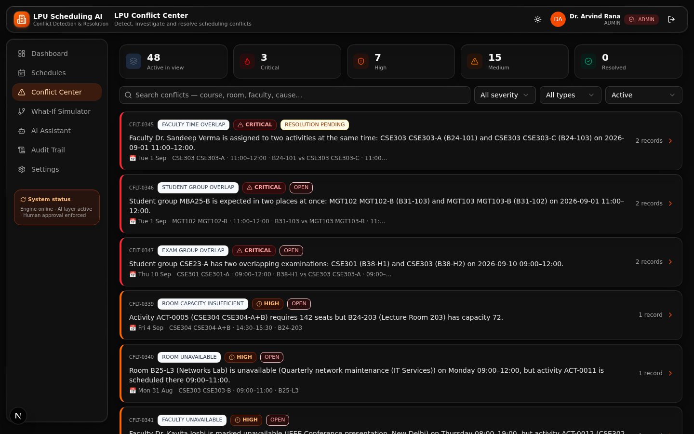 |

Full dark theme with re-tuned glass tokens: deeper shadows, dimmer hairlines, adjusted ambient light. Toggle lives in the top bar; the choice persists (`next-themes`).

### 7.12 Mobile

| Navigation drawer | Conflict Center |
|---|---|
| 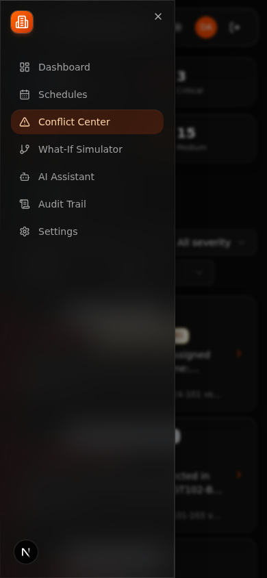 | 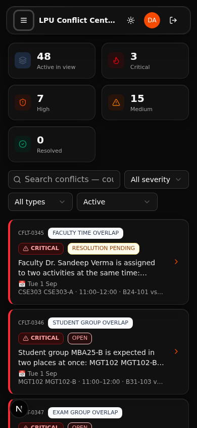 |

Below the `md` breakpoint the sidebar collapses into a left **Sheet drawer** (350 ms in / 250 ms out); the top bar keeps identity, theme and notifications. Lists, cards, filters and the AI pipeline all reflow to a single column; the demo was verified at 390×844.

---

## 8. Responsive behavior

- **Desktop (≥ `md`)** — persistent left navigation (role-filtered), floating glass top bar, multi-column KPI grid, side-by-side conflict records.
- **Mobile (< `md`)** — Sheet drawer navigation, stacked cards, horizontally scrollable tables, full-width dialogs becoming drawers where appropriate (`vaul` bottom sheets on touch).
- Breakpoints are Tailwind's default scale; the shell uses a `useIsMobile()` hook (`src/hooks/use-mobile.ts`) to switch navigation chrome.
- Navigation is **role-filtered server-verified**: the client hides what a role cannot use, and every API route re-checks the session role — hiding is never the security boundary.

## 9. Where to look in the code

| Topic | File |
|---|---|
| Design tokens, glass utilities, a11y blocks | `src/app/globals.css` |
| Domain badges, KPI card, empty states | `src/components/shared/ui-bits.tsx` |
| App shell, navigation, role filtering | `src/components/app/app-shell.tsx` |
| Login (demo role cards) | `src/components/app/login-view.tsx` |
| View keys & titles | `src/store/app-store.ts` |
| View implementations | `src/components/<view>/` |
